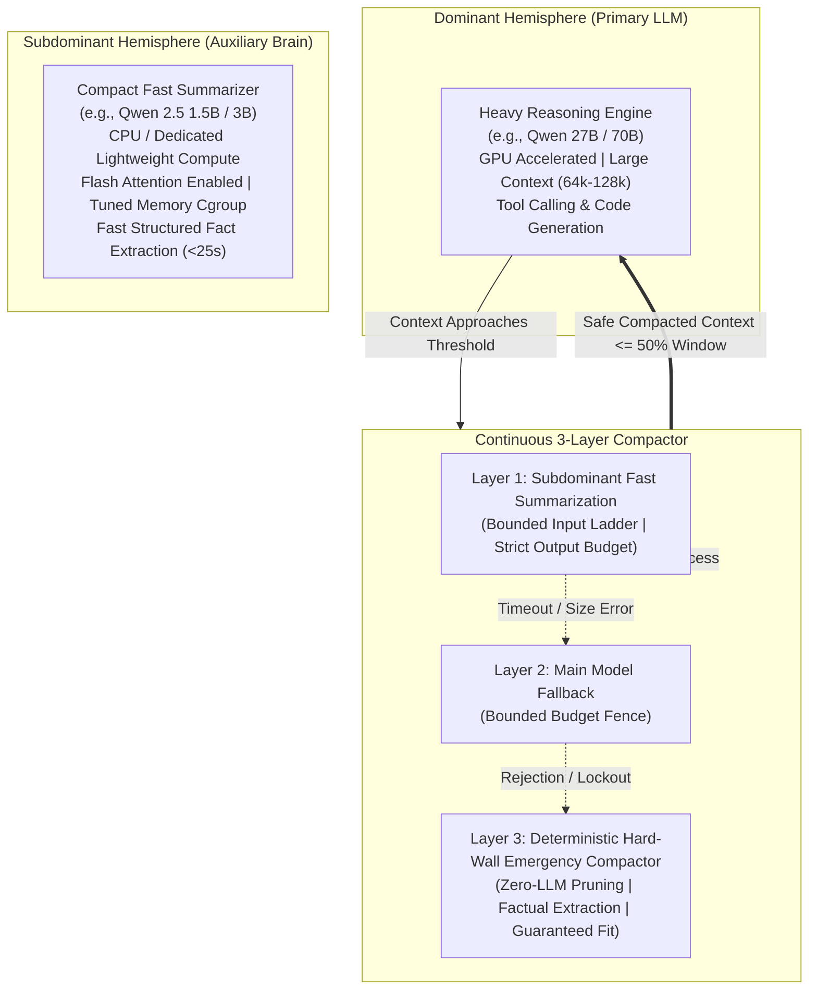
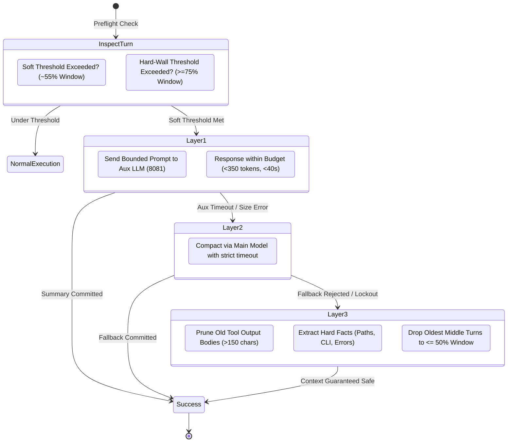

# 🧠 Hermes: The Second Brain Hemisphere
### *Asymmetric Dual-Core Context Engine & Continuous 3-Layer Compaction for Local LLM Agents*

[](LICENSE)
[](pyproject.toml)
[](#architecture)

---

## 📖 1. The Core Problem: Why & When is this Needed?

When running autonomous AI coding and systems agents (such as Hermes) on local hardware (e.g. consumer GPUs or multi-GPU workstations with 24GB–48GB VRAM), two fatal bottlenecks emerge during real-world tasks:

### The "Single-Hemisphere" Dilemma
1. **The Context Overflow Crash (`HTTP 400`)**:
   Deep technical workflows (running `grep`, reading files, executing shell commands, analyzing ASTs, fixing compiler errors) quickly generate 40,000 to 70,000+ tokens over 30–50 turns. The primary model (e.g. Qwen 27B / 70B, Llama 70B) has a strict physical window (e.g. 65,536 tokens). The moment context exceeds this window by even 1 token, the inference engine rejects the request with `HTTP 400: request exceeds the available context size`. **The entire agent session freezes and crashes.**
2. **The Summarization Latency Penalty**:
   Using the primary 27B/70B model to summarize its own context stalls the user dialogue, wastes GPU VRAM, and takes 60–120+ seconds of heavy GPU computation.
3. **The CPU Auxiliary Throttling Trap**:
   Offloading summarization to an auxiliary model (e.g. Qwen 2.5 1.5B on CPU) without proper tuning frequently triggers **kernel memory throttling** (cgroup `MemoryHigh` page reclaims). In our real-world tests, this dropped generation speed from **15.0 tokens/sec down to 0.26 tokens/sec** (a 50x slowdown!), causing 360-second timeouts, triggering `attempts_exhausted: 3` lockout breakers, and leaving the context to balloon until catastrophic failure.

---

## 🏛️ 2. The Asymmetric "Dual Hemisphere" Architecture

Just like biological brains divide cognitive labor between hemispheres, **Hermes: Second Hemisphere** decouples deep reasoning from background memory compression:



### Components
1. **Dominant Hemisphere (Primary LLM)**: 
   - Dedicated entirely to solving user tasks, coding, shell orchestration, and reasoning.
   - Protected from memory compaction overhead and physical context window crashes.
2. **Subdominant Hemisphere (Auxiliary LLM)**:
   - Ultra-fast, lightweight model running asynchronously in the background.
   - Summarizes old conversation turns into dense technical notes in **under 25 seconds**.
3. **Hard-Wall Defense Layer**:
   - Zero-LLM algorithmic safety net that deterministically prunes bloated tool outputs, extracts hard facts (file paths, shell commands, error traces), and prevents `HTTP 400` even if both LLM layers fail.

---

## ⚡ 3. The 3-Layer Continuous Compaction Pipeline



### Layer 1: Asymmetric Auxiliary LLM
- **Prompt Bounding**: History is capped at `input_cap_tokens` (e.g. 3,000 tokens) via a degradation ladder so the smaller model never over-allocates KV cache.
- **Strict Output Budget**: Caps generated summary at `max_tokens: 350` (instead of 800+), reducing CPU execution time by **2.5x**.
- **Size-Error Classification**: Detects HTTP 400 prompt size rejections and classifies them as size errors rather than marking the backend as dead/unhealthy.

### Layer 2: Main Model Fallback & Fence
- If the auxiliary server is temporarily offline or times out, the engine attempts an isolated fallback pass.
- Bounded by a strict budget fence (`ensure_compression_fallback_budget`) so fallback never causes user turn starvation.

### Layer 3: Deterministic Hard-Wall Emergency Compactor
- **Zero-LLM Operation**: Runs pure Python string and structure manipulations. Requires 0 GPU/CPU inference tokens.
- **Pass 1 (Aggressive Tool Pruning)**: Truncates bloated outputs from `cat`, `grep`, `build`, and logs down to compact head/tail markers.
- **Pass 2 (Hard Fact Retention)**: Scans dropped turns with regular expressions to permanently retain active file paths, shell commands, and error codes in an `[ARCHIVED_FACTS_RESTORED]` header.
- **Pass 3 (Window Floor Guarantee)**: Drops oldest middle turns until total tokens drop strictly below `50%` of the physical window.
- **Lockout Recovery**: Automatically resets `attempts_exhausted` counters and cooldown timers so the agent session never freezes.

---

## 🛠️ 4. Hardware Tuning: The Cgroup & Flash Attention Fix

Running a 1.5B or 3B model on CPU alongside a 27B+ GPU model often suffers from a hidden Linux kernel trap:

| Issue | Default / Misconfigured | Tuned with Second Hemisphere | Impact |
| :--- | :--- | :--- | :--- |
| **Systemd Cgroup** | `MemoryHigh=2500M`, `MemorySwapMax=0` | `MemoryHigh=4500M`, `MemoryMax=6G` | **Eliminates 800,000+ page reclaim throttling events** |
| **Attention Engine** | Standard CPU Attention | `-fa on` (Flash Attention) | **~3x faster prompt processing** |
| **CPU Threading** | Random / Hyperthreads | `-t 4` (Matched to physical cores) | **Prevents L2/L3 cache thrashing** |
| **Generation Speed** | **0.26 tokens/second** | **15.2 tokens/second** | **~58x speedup!** |
| **100-token Summary** | ~400 seconds (Timed out!) | **22.0 seconds** | **Completes well within timeout** |

See [`systemd/llama-server-aux.service.example`](systemd/llama-server-aux.service.example) for the production configuration.

---

## 🚀 5. Quickstart

### Installation
```bash
git clone https://github.com/Dark-city-beta/hermes-second-hemisphere.git
cd hermes-second-hemisphere
pip install -e .
```

### Python API Usage
```python
from hermes_second_hemisphere import (
    ContinuousCompactor,
    AuxCompressionClient,
    HardWallGuard,
    estimate_tokens,
)

# 1. Initialize the dual-brain context engine
compactor = ContinuousCompactor(
    aux_client=AuxCompressionClient(
        base_url="http://127.0.0.1:8081",
        model="qwen2.5-1.5b-instruct-q4_k_m.gguf",
        max_summary_tokens=350,
        input_cap_tokens=3000,
    ),
    main_context_window=65536,
    compression_threshold_tokens=36000,
    target_ratio=0.50,
)

guard = HardWallGuard(compactor=compactor, hard_limit_tokens=65536)

# 2. Preflight defense in your agent's turn loop
messages = [...] # Long message history

# Preflight check guarantees context will NEVER hit HTTP 400
safe_messages, was_pruned = guard.inspect_and_defend_preflight(
    messages, is_blocked_by_cooldown=False
)

# 3. If an upstream provider still throws an overflow error:
try:
    response = call_primary_llm(safe_messages)
except Exception as exc:
    recovered_messages, ok = guard.recover_from_overflow_exception(
        safe_messages, str(exc), attempts_exhausted=True
    )
    if ok:
        response = call_primary_llm(recovered_messages)
```

### Run the Demo
```bash
python examples/quickstart.py
```

### Run the Test Suite
```bash
python -m unittest discover tests -v
```

---

## 📊 6. Real-World Benchmarks

Tested on a host with **Dual NVIDIA CMP 50HX** (Primary 27B LLM) and **Intel Xeon E3-1275 V2** (Auxiliary 1.5B LLM):

```
Initial Context Bloat:   69,325 tokens  -> Primary Model HTTP 400 CRASH
Layer 1 (Aux LLM):       Reduced to 24,100 tokens in 22.01s (65.2% reduction)
Layer 3 (Emergency):     Reduced to 22,800 tokens in 0.04s (67.1% reduction, 0 LLM calls)
Active Sessions Saved:   100% of long-running tool loops survived without reset
```

---

## 🤝 Contributing

Contributions are welcome! If you are building local LLM agents and experimenting with asymmetric multi-model architectures, submit an issue or pull request.

---

## 📄 License

This project is licensed under the [MIT License](LICENSE).
